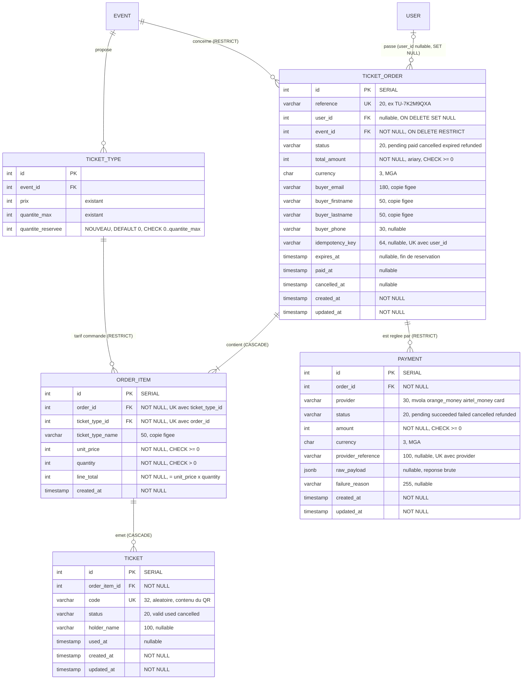
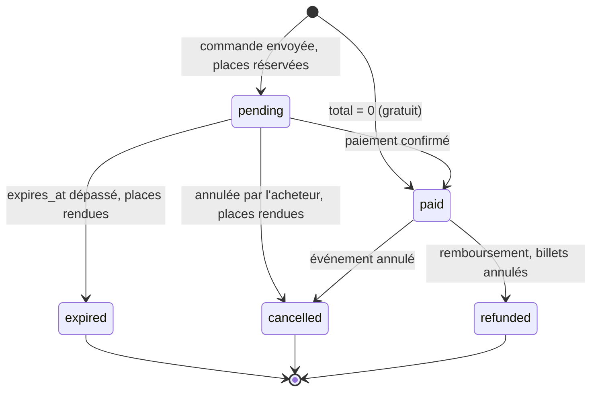

# Proposition : commande de billets

> **Statut : lot 1 implémenté (2026-11-20)** — migration `Version20261120125310`, tests au vert. Le lot 2 (`payment`) reste à faire. Ce document part de l'état décrit dans [`data-dictionary.md`](data-dictionary.md) et des anomalies de [`open-questions.md`](open-questions.md). Les choix à valider avec l'équipe sont listés en fin de document.

## 1. Besoin

Un utilisateur connecté choisit un événement publié, sélectionne une quantité par tarif (`ticket_type`), et **envoie une commande**. La commande réserve les places le temps du paiement. Une fois payée (ou immédiatement si elle est gratuite), elle produit **un billet par place**, avec un code unique destiné au QR code.

Aujourd'hui, `ticket_type` n'est qu'une offre (nom, `prix`, `quantite_max`) : rien n'enregistre ce qui a été vendu, donc rien n'empêche de vendre plus que le quota.

## 2. Vue d'ensemble

4 nouvelles tables et 1 colonne ajoutée à une table existante :

| Table | Rôle | Lot |
|---|---|---|
| `ticket_order` | La commande : acheteur, événement, statut, montant total | 1 |
| `order_item` | Les lignes de commande : un tarif, une quantité, le prix figé au moment de l'achat | 1 |
| `ticket` | Les billets émis : un par place, avec un code unique pour le QR | 1 |
| `payment` | Les tentatives de paiement (mobile money, carte…) | 2 (dès que le prestataire de paiement est choisi) |
| `ticket_type.quantite_reservee` | Compteur des places prises (en attente de paiement + payées) | 1 |



## 3. Choix de conception

### 3.1 Cohérence avec l'existant ([`conventions.md`](conventions.md))

| Sujet | Choix | Raison |
|---|---|---|
| Clés primaires | `INT` auto-incrémenté (`SERIAL`) | Comme toutes les tables actuelles |
| Identifiants publics | `ticket_order.reference` et `ticket.code` aléatoires, uniques | Ne pas exposer d'`id` séquentiel : sinon on peut deviner les commandes des autres (`/orders/124`, `/orders/125`…) |
| Montants | `INT` en ariary, sans décimales | Même règle que `ticket_type.prix` ([BR-TKT-02](business-rules.md)) |
| Devise | Colonne `currency CHAR(3)` = `MGA` | Coûte une colonne aujourd'hui, évite une migration de données plus tard (Q-30) |
| Statuts | Enums PHP adossés à des chaînes (`OrderStatus`, `TicketStatus`, `PaymentStatus`) en `VARCHAR(20)` **avec `CHECK` SQL** | Même mécanisme qu'`OrganizerRole`, plus le `CHECK` qui manque aujourd'hui (Q-20) |
| Horodatage | `PrePersist` / `PreUpdate` | La convention correcte (`User`, `OrganizerMembership`), pas celle du constructeur (Q-29) |
| Dates | `datetime_immutable` (`TIMESTAMP WITHOUT TIME ZONE`) | Cohérence avec le reste ; **dépend de la réponse à Q-04** (fuseau). Recommandation : écrire en UTC. |
| Nom de table | `ticket_order` et non `order` | `ORDER` est un mot réservé SQL : il faudrait l'échapper partout, comme `"user"` |
| Nommage | Colonnes en anglais | Majorité du modèle. Exception : `quantite_reservee`, ajoutée à `ticket_type` pour rester cohérente avec ses voisines `prix` et `quantite_max` |

### 3.2 Une commande = un événement

`ticket_order.event_id` est obligatoire et tous les tarifs commandés doivent appartenir à cet événement. Raisons :

- les droits côté organisateur se déduisent simplement : `ticket_order → event → organizer → organizer_membership`, la même chaîne que [BR-EVT-05](business-rules.md) ;
- comptabilité et remboursements par organisation sans ventilation ;
- un panier multi-événements pourra plus tard regrouper plusieurs commandes.

L'appartenance des tarifs à l'événement est vérifiée par le service, et par la clause `AND event_id = :event` de la réservation atomique (§ 4).

### 3.3 Figer ce qui peut changer

Le prix et le nom d'un tarif peuvent être modifiés après la vente, et le compte d'un acheteur supprimé. Une commande doit rester lisible et juste. On fige donc :

- `order_item.unit_price`, `ticket_type_name` et `line_total` ;
- `ticket_order.total_amount`, **calculé côté serveur** à partir des prix en base, jamais à partir du corps de la requête ;
- les coordonnées de l'acheteur (`buyer_*`).

### 3.4 Ne jamais vendre plus que le quota

C'est le point critique. Deux acheteurs simultanés ne doivent pas obtenir la dernière place tous les deux. On ajoute un compteur `ticket_type.quantite_reservee`, modifié par **une seule requête SQL conditionnelle** :

```sql
UPDATE ticket_type
SET    quantite_reservee = quantite_reservee + :quantite
WHERE  id = :ticket_type_id
  AND  event_id = :event_id
  AND  quantite_reservee + :quantite <= quantite_max;
-- 0 ligne modifiée  ⇒  plus assez de places (409)
```

PostgreSQL verrouille la ligne pendant la mise à jour : la condition est réévaluée pour le second acheteur, sans risque de course. Un `CHECK (quantite_reservee BETWEEN 0 AND quantite_max)` sert de dernier filet. Il empêche aussi un organisateur de baisser `quantite_max` sous le nombre de places déjà vendues.

> ⚠️ Cette mise à jour doit passer par DQL `UPDATE` ou DBAL, **pas** par `$ticketType->setQuantiteReservee()` suivi d'un `flush()`. Lire, ajouter puis réécrire perd des ventes simultanées.

Alternative écartée : recalculer `SUM(order_item.quantity)` à chaque commande avec `SELECT … FOR UPDATE`. C'est plus lent, et il faut penser à verrouiller à chaque endroit qui vend.

Ce compteur limite le **quota du tarif**, pas la jauge du lieu (`location.size`). La sur-réservation volontaire des fixtures ([BR-TKT-03](business-rules.md)) reste donc possible. Faut-il aussi bloquer à la jauge ? Voir question D-07.

### 3.5 Réservation temporaire

Une commande `pending` bloque ses places jusqu'à `expires_at` (15 minutes proposées). Une commande console planifiée (`app:order:expire`, chaque minute) passe les commandes échues en `expired` et rend les places. Sans cela, des paniers abandonnés finiraient par épuiser le stock.

### 3.6 Renvois réseau (mobile)

Sur un réseau mobile instable, l'application peut renvoyer la même requête. Le client envoie un en-tête `Idempotency-Key`, stocké dans `ticket_order.idempotency_key` avec une unicité `(user_id, idempotency_key)`. Un renvoi retourne la commande déjà créée au lieu d'en créer une seconde.

### 3.7 Suppressions

| Relation | `ON DELETE` | Raison |
|---|---|---|
| `ticket_order.user_id` → `user` | `SET NULL` | Une commande est une pièce comptable : elle survit à la suppression du compte (RGPD : les `buyer_*` peuvent alors être anonymisés) |
| `ticket_order.event_id` → `event` | `RESTRICT` | Impossible de supprimer un événement qui a des ventes |
| `order_item.ticket_type_id` → `ticket_type` | `RESTRICT` | Impossible de supprimer un tarif vendu |
| `order_item.order_id` → `ticket_order` | `CASCADE` | Les lignes n'existent qu'avec leur commande |
| `ticket.order_item_id` → `order_item` | `CASCADE` | Idem pour les billets |
| `payment.order_id` → `ticket_order` | `RESTRICT` | Une trace de paiement ne disparaît jamais |

Une commande n'est jamais supprimée, seulement annulée : les `CASCADE` internes ne servent qu'au nettoyage en développement (`doctrine:fixtures:load`).

## 4. Cycle de vie



### Envoi d'une commande — `POST /api/orders`

Corps proposé :

```json
{
  "eventId": 12,
  "items": [
    { "ticketTypeId": 31, "quantity": 2 },
    { "ticketTypeId": 32, "quantity": 1 }
  ]
}
```

Traitement, dans **une seule transaction** :

1. **Contrôles** : utilisateur connecté ; événement publié (`status = true`) et non terminé ; au moins une ligne ; quantités entre 1 et le maximum par commande (D-02) ; aucun tarif en double.
2. **Réservation** : pour chaque ligne, **triée par `ticket_type_id`** (deux commandes croisées ne peuvent pas se bloquer mutuellement), l'`UPDATE` conditionnel du § 3.4. Un échec annule tout : erreur `409`, « Plus assez de places pour le tarif X ».
3. **Écriture** : `ticket_order` (`pending`, `expires_at = now + 15 min`, `reference` aléatoire, copie des coordonnées), puis les `order_item` avec les prix lus en base.
4. **Gratuit** : si `total_amount = 0`, statut `paid`, `paid_at = now` et émission immédiate des billets.
5. `COMMIT`, puis réponse `201` dans l'enveloppe habituelle `{ message, status, data }`.

### Confirmation de paiement (lot 2)

Notification du prestataire → `payment.status = succeeded`, puis verrouillage de la commande (`SELECT … FOR UPDATE`). Si elle est encore `pending` : `paid`, `paid_at`, création des `ticket` (un par unité de chaque ligne, avec un `code` aléatoire). Cas limite : paiement reçu après expiration, voir D-05.

### Expiration et annulation

Statut `expired` ou `cancelled`, puis `quantite_reservee = quantite_reservee - quantity` pour chaque ligne, dans la même transaction. Le `CHECK >= 0` détecte un double décrément.

## 5. DDL indicatif (PostgreSQL 16)

À produire avec `doctrine:migrations:diff` à partir des entités, puis à **compléter à la main** par les `CHECK` et l'index partiel. Doctrine ne les génère pas, et comme DBAL ne les relit pas dans la base, il ne les supprimera pas lors des diffs suivants.

```sql
ALTER TABLE ticket_type ADD quantite_reservee INT DEFAULT 0 NOT NULL;
ALTER TABLE ticket_type ADD CONSTRAINT chk_ticket_type_reservee
    CHECK (quantite_reservee >= 0 AND quantite_reservee <= quantite_max);

CREATE TABLE ticket_order (
    id               SERIAL PRIMARY KEY,
    reference        VARCHAR(20)  NOT NULL,
    user_id          INT          DEFAULT NULL REFERENCES "user"(id) ON DELETE SET NULL,
    event_id         INT          NOT NULL REFERENCES event(id) ON DELETE RESTRICT,
    status           VARCHAR(20)  NOT NULL,
    total_amount     INT          NOT NULL,
    currency         CHAR(3)      NOT NULL,
    buyer_email      VARCHAR(180) NOT NULL,
    buyer_firstname  VARCHAR(50)  NOT NULL,
    buyer_lastname   VARCHAR(50)  NOT NULL,
    buyer_phone      VARCHAR(30)  DEFAULT NULL,
    idempotency_key  VARCHAR(64)  DEFAULT NULL,
    expires_at       TIMESTAMP(0) WITHOUT TIME ZONE DEFAULT NULL,
    paid_at          TIMESTAMP(0) WITHOUT TIME ZONE DEFAULT NULL,
    cancelled_at     TIMESTAMP(0) WITHOUT TIME ZONE DEFAULT NULL,
    created_at       TIMESTAMP(0) WITHOUT TIME ZONE NOT NULL,
    updated_at       TIMESTAMP(0) WITHOUT TIME ZONE NOT NULL,
    CONSTRAINT chk_order_status  CHECK (status IN ('pending','paid','cancelled','expired','refunded')),
    CONSTRAINT chk_order_total   CHECK (total_amount >= 0),
    CONSTRAINT chk_order_pending CHECK (status <> 'pending' OR expires_at IS NOT NULL)
);
CREATE UNIQUE INDEX uniq_order_reference   ON ticket_order (reference);
CREATE UNIQUE INDEX uniq_order_idempotency ON ticket_order (user_id, idempotency_key);
CREATE INDEX idx_order_user_created        ON ticket_order (user_id, created_at);  -- « mes commandes »
CREATE INDEX idx_order_event_status        ON ticket_order (event_id, status);     -- ventes d'un événement
CREATE INDEX idx_order_pending_expiry      ON ticket_order (expires_at) WHERE status = 'pending'; -- purge

CREATE TABLE order_item (
    id                SERIAL PRIMARY KEY,
    order_id          INT         NOT NULL REFERENCES ticket_order(id) ON DELETE CASCADE,
    ticket_type_id    INT         NOT NULL REFERENCES ticket_type(id) ON DELETE RESTRICT,
    ticket_type_name  VARCHAR(50) NOT NULL,
    unit_price        INT         NOT NULL,
    quantity          INT         NOT NULL,
    line_total        INT         NOT NULL,
    created_at        TIMESTAMP(0) WITHOUT TIME ZONE NOT NULL,
    CONSTRAINT chk_item_price    CHECK (unit_price >= 0),
    CONSTRAINT chk_item_quantity CHECK (quantity > 0),
    CONSTRAINT chk_item_total    CHECK (line_total = unit_price * quantity)
);
CREATE UNIQUE INDEX uniq_item_order_type ON order_item (order_id, ticket_type_id);
CREATE INDEX idx_item_ticket_type        ON order_item (ticket_type_id);

CREATE TABLE ticket (
    id             SERIAL PRIMARY KEY,
    order_item_id  INT          NOT NULL REFERENCES order_item(id) ON DELETE CASCADE,
    code           VARCHAR(32)  NOT NULL,
    status         VARCHAR(20)  NOT NULL,
    holder_name    VARCHAR(100) DEFAULT NULL,
    used_at        TIMESTAMP(0) WITHOUT TIME ZONE DEFAULT NULL,
    created_at     TIMESTAMP(0) WITHOUT TIME ZONE NOT NULL,
    updated_at     TIMESTAMP(0) WITHOUT TIME ZONE NOT NULL,
    CONSTRAINT chk_ticket_status CHECK (status IN ('valid','used','cancelled')),
    CONSTRAINT chk_ticket_used   CHECK (status <> 'used' OR used_at IS NOT NULL)
);
CREATE UNIQUE INDEX uniq_ticket_code ON ticket (code);
CREATE INDEX idx_ticket_order_item   ON ticket (order_item_id);

-- Lot 2
CREATE TABLE payment (
    id                  SERIAL PRIMARY KEY,
    order_id            INT          NOT NULL REFERENCES ticket_order(id) ON DELETE RESTRICT,
    provider            VARCHAR(30)  NOT NULL,
    status              VARCHAR(20)  NOT NULL,
    amount              INT          NOT NULL,
    currency            CHAR(3)      NOT NULL,
    provider_reference  VARCHAR(100) DEFAULT NULL,
    raw_payload         JSONB        DEFAULT NULL,
    failure_reason      VARCHAR(255) DEFAULT NULL,
    created_at          TIMESTAMP(0) WITHOUT TIME ZONE NOT NULL,
    updated_at          TIMESTAMP(0) WITHOUT TIME ZONE NOT NULL,
    CONSTRAINT chk_payment_status CHECK (status IN ('pending','succeeded','failed','cancelled','refunded')),
    CONSTRAINT chk_payment_amount CHECK (amount >= 0)
);
CREATE INDEX idx_payment_order ON payment (order_id);
CREATE UNIQUE INDEX uniq_payment_provider_ref ON payment (provider, provider_reference);
-- Au plus un paiement réussi par commande :
CREATE UNIQUE INDEX uniq_payment_succeeded ON payment (order_id) WHERE status = 'succeeded';
```

Remarques :

- l'unicité `(user_id, idempotency_key)` laisse passer les lignes où l'une des valeurs est `NULL` (comportement PostgreSQL), ce qui est voulu ;
- `uniq_payment_provider_ref` empêche de traiter deux fois la même notification du prestataire ;
- `jsonb` se mappe en Doctrine par `type: 'json'` avec `options: ['jsonb' => true]`.

## 6. Impacts sur l'existant

| Élément existant | Impact | Action recommandée |
|---|---|---|
| `Event::$ticket_type` (`cascade remove`, `orphanRemoval`) | Supprimer un événement ou retirer un tarif **vendu** échouera sur la FK `RESTRICT` (`ForeignKeyConstraintViolationException`) | C'est voulu. Traduire l'erreur en `409`, et prévoir de **désactiver** un tarif plutôt que le supprimer (colonne `is_active`, voir D-09) |
| `Location::$events`, `Organizer::$events` (`orphanRemoval`, Q-05) | La suppression d'un lieu ou d'une organisation tenterait de supprimer des événements qui ont des ventes : bloquée par `RESTRICT` | **Fait** : `orphanRemoval` retiré, refus traduits en `409` (`IntegrityConstraintSubscriber`) |
| `TicketType` | Nouveau champ `quantite_reservee` | Le rendre **non modifiable par l'API**. Exposer en lecture `quantite_disponible = quantite_max - quantite_reservee` dans `events:lists` |
| `EventInputDenormalizer` | Aucun (création d'événement uniquement) | — |
| `User` | Nouvelle collection inverse `orders` facultative | Ne pas mettre `orphanRemoval` |
| `security.yaml` | Tout `/api` est public par défaut | `#[IsGranted('ROLE_USER')]` sur les endpoints de commande ; pour les ventes vues par l'organisateur, `OrganizerVoter::VIEW` sur `event.organizer` |
| `EventFixtures` | Pas de commandes en démonstration | Ajouter une `OrderFixtures` (commandes payées, en attente, expirées, gratuites) et garder `quantite_reservee` cohérent avec elles |
| `GET /api/events` (N+1, Q-12) | Exposer le stock restant charge encore les tarifs | Joindre `ticket_type` dans la requête de liste |

Nouveaux éléments applicatifs (pour mémoire) : entités `TicketOrder`, `OrderItem`, `Ticket`, `Payment` ; enums `OrderStatus`, `TicketStatus`, `PaymentStatus` ; `OrderService` (toutes les écritures, sur le modèle d'`OrganizerMembershipService`) ; `OrderException` qui étend `BusinessException` ; commande `app:order:expire`.

## 7. Endpoints envisagés

| Méthode | Route | Droit |
|---|---|---|
| POST | `/api/orders` | authentifié |
| GET | `/api/orders/me` | authentifié (ses commandes) |
| GET | `/api/orders/{reference}` | l'acheteur, ou VIEW sur l'organisation de l'événement |
| POST | `/api/orders/{reference}/cancel` | l'acheteur, tant que la commande est `pending` |
| GET | `/api/events/{id}/orders` | VIEW sur l'organisation de l'événement |

(`/events/{id}` est contraint à `\d+` : `/events/{id}/orders` ne crée pas de conflit de route.)

## 8. Décisions à prendre avec l'équipe

| ID | Question | Proposition par défaut |
|---|---|---|
| D-01 | Achat sans compte (invité) ? | Non au lot 1 (`user_id` est déjà nullable : l'ajouter plus tard ne demandera pas de migration) |
| D-02 | Nombre maximal de billets par commande ou par acheteur ? | 10 par commande, contrôlé par le service ; une colonne `ticket_type.max_par_commande` si cela doit varier selon le tarif |
| D-03 | Jusqu'à quand vend-on : avant `started_at` ou jusqu'à `end_at` ? | Jusqu'à `end_at` (utile pour les expositions qui durent plusieurs semaines) |
| D-04 | Durée de réservation d'une commande en attente ? | 15 minutes |
| D-05 | Paiement reçu après expiration de la commande ? | Accepté si les places sont encore disponibles (nouvelle réservation), sinon remboursement automatique |
| D-06 | Prestataires de paiement (MVola, Orange Money, Airtel Money, carte) ? | Conditionne le lot 2 et les valeurs de `payment.provider` |
| D-07 | Bloquer aussi à la jauge du lieu (`location.size`) ? | Non : le quota par tarif suffit, l'organisateur reste responsable de la cohérence quotas / jauge |
| D-08 | Billets nominatifs ? | `holder_name` facultatif |
| D-09 | Fenêtre de vente par tarif et désactivation d'un tarif ? | Lot 2 : `ticket_type.sale_starts_at`, `sale_ends_at`, `is_active` |
| D-10 | Frais de service, codes promo, remboursements partiels ? | Hors périmètre. Prévoir `ticket_order.fees_amount` et une table `refund` le moment venu |
| D-11 | Fuseau horaire de référence (Q-04) ? | UTC en base, conversion à l'affichage |

## 9. Tests écrits avant l'implémentation

> Écrits avant le code (le 2026-11-20), ils passent désormais tous : 113 tests, 437 assertions. `payment` (lot 2) n'est pas couvert.

### Lancer les tests

```bash
# une fois : .env.test.local (non versionné) avec DATABASE_URL et JWT_PASSPHRASE, comme .env.local
php bin/console doctrine:database:create --env=test --if-not-exists
php bin/console doctrine:migrations:migrate -n --env=test   # les migrations, pas schema:create (CHECK SQL)
php bin/phpunit
```

La base de test est `<base>_test` (`dbname_suffix` dans `doctrine.yaml`). Elle est vidée avant **chaque** test, et `DatabaseTestCase` refuse de vider une base dont le nom ne contient pas `_test`.

### Organisation

| Dossier | Contenu |
|---|---|
| `tests/Support/` | `DatabaseTestCase` (purge de la base), `ApiTestCase` (requêtes HTTP authentifiées par JWT), `OrderTestCase` (aides commande), `TestData` (fabrique de données) |
| `tests/Unit/` | Enums de statut, entités `TicketOrder` / `OrderItem` / `TicketType`, générateur de référence (sans base) |
| `tests/Integration/Order/` | `PlaceOrderTest` (envoi, stock, idempotence, refus), `OrderLifecycleTest` (annulation, paiement, expiration), `OrderSchemaTest` (contraintes SQL de la migration) |
| `tests/Integration/Command/` | `app:order:expire` |
| `tests/Functional/` | Endpoints HTTP des commandes, places restantes dans `/api/events`, test de fumée de l'outillage |

### Contrat de code fixé par les tests

| Élément | Contrat |
|---|---|
| `App\Enum\OrderStatus` | `pending`, `paid`, `cancelled`, `expired`, `refunded` ; `holdsSeats()`, `isFinal()`, `label()` |
| `App\Enum\TicketStatus` | `valid`, `used`, `cancelled` |
| `App\Entity\TicketOrder` | constructeur sans argument (statut `PENDING`, devise `MGA`, total 0) ; `addItem()` recalcule `getTotalAmount()` et `getTicketCount()` ; accesseurs `getReference()`, `getUser()`, `getEvent()`, `getStatus()`, `getCurrency()`, `getBuyerEmail/Firstname/Lastname/Phone()`, `getExpiresAt()`, `getPaidAt()`, `getCancelledAt()`, `getItems()` |
| `App\Entity\OrderItem` | `OrderItem::fromTicketType(TicketType, int $quantity)` fige nom et prix ; `getTicketType()`, `getTicketTypeName()`, `getUnitPrice()`, `getQuantity()`, `getLineTotal()`, `getOrder()`, `getTickets()` |
| `App\Entity\Ticket` | `getCode()` (16 à 32 caractères alphanumériques, unique), `getStatus(): TicketStatus` |
| `App\Entity\TicketType` | `getQuantiteReservee()` (0 par défaut, sans setter public), `getQuantiteDisponible()` ; exposé dans `events:lists` sous la clé `quantite_disponible` |
| `App\Service\Order\OrderReferenceGenerator` | `generate()` → `TU-` + 8 caractères parmi `A-HJ-NP-Z2-9` |
| `App\Service\Order\OrderService` | constantes `RESERVATION_MINUTES = 15`, `MAX_TICKETS_PER_ORDER = 10` ; `place(User, int $eventId, list<array{ticketTypeId:int, quantity:int}>, ?string $idempotencyKey = null): TicketOrder` ; `cancel(TicketOrder, User $actor)` ; `markAsPaid(TicketOrder)` (idempotent) ; `expirePending(?\DateTimeImmutable $now = null): int` |
| `App\Exception\OrderException` | étend `BusinessException` |
| Commande | `app:order:expire`, affiche le nombre de commandes expirées |

Codes d'erreur attendus de `OrderService` (`OrderException::getStatusCode()`) :

| Cas | Code |
|---|---|
| Événement inexistant **ou brouillon** (on ne révèle pas un brouillon) | 404 |
| Événement terminé | 409 |
| Aucune ligne, quantité ≤ 0, tarif en double, plus de 10 billets, tarif inexistant ou d'un autre événement | 400 |
| Stock insuffisant (le message nomme le tarif) ; rien n'est réservé ni écrit | 409 |
| Annuler la commande d'un autre | 404 |
| Annuler une commande qui n'est plus `pending` ; payer une commande annulée | 409 |

Contrat HTTP (enveloppe `{ message, status, data }`) :

| Requête | Réponses testées |
|---|---|
| `POST /api/orders` | `201` ; `200` avec la même commande si l'`Idempotency-Key` est rejouée ; `400` (corps non JSON, champs manquants ou mal typés, clé de plus de 64 caractères) ; `401` ; `404` ; `409` |
| `GET /api/orders/me` | `200`, pagination `page` / `itemsPerPage` (`itemsTotal`, `currentPage`, `nombreParPage`, `items`), de la plus récente à la plus ancienne ; `401` |
| `GET /api/orders/{reference}` | `200` pour l'acheteur, un membre de l'organisation de l'événement ou le super admin ; `404` pour les autres et pour une référence inconnue ; `401` |
| `POST /api/orders/{reference}/cancel` | `200` ; `404` (commande d'un autre) ; `409` (commande payée) ; `401` |
| `GET /api/events/{id}/orders` | `200` pour un membre de l'organisation (avec `buyer.email`) ; `403` pour un non-membre ; `404` ; `401` |

Forme d'une commande dans `data` : `reference`, `status`, `totalAmount`, `currency`, `expiresAt` / `paidAt` (ATOM ou `null`), `event.id`, `items[]` (`ticketTypeId`, `name`, `unitPrice`, `quantity`, `lineTotal`), `tickets[]` (`code`, `status`, `ticketTypeName`), et `buyer` (au moins `email`) dans la vue organisateur. **Jamais d'`id`.**

## 10. Implémentation (lot 1)

| Élément | Fichier |
|---|---|
| Entités | `src/Entity/TicketOrder.php`, `OrderItem.php`, `Ticket.php` ; `TicketType::$quantiteReservee` |
| Enums | `src/Enum/OrderStatus.php`, `TicketStatus.php` |
| Service | `src/Service/Order/OrderService.php` (écritures), `OrderReferenceGenerator.php`, `OrderPresenter.php` |
| Droits | `src/Security/Voter/OrderVoter.php` (lecture) ; l'annulation est contrôlée par le service |
| Contrôleurs | `src/Controller/Api/Order/*` (routes Symfony classiques) |
| Erreurs | `src/Exception/OrderException.php` |
| Console | `app:order:expire` (`src/Command/ExpireOrdersCommand.php`) |
| Migration | `migrations/Version20261120125310.php` (DDL générée par Doctrine + CHECK ajoutés à la main ; `down()` exécutable, testé) |
| OpenAPI | `src/OpenApi/OrderEndpointsFactory.php` (second décorateur, à côté de `UndocumentedEndpointsFactory`) |
| Fixtures | `src/DataFixtures/OrderFixtures.php` |

Écarts et précisions par rapport aux sections précédentes :

- **Index partiel** : la clause est écrite `WHERE ((status)::text = 'pending'::text)`, forme normalisée renvoyée par PostgreSQL. Avec `status = 'pending'`, `doctrine:migrations:diff` proposait à chaque fois de supprimer puis recréer l'index.
- **Index FK automatiques** : Doctrine ajoute `IDX_…` sur `user_id`, `event_id` et `order_id`, même s'ils sont couverts par un index composite. Ils sont conservés (même choix que pour `organizer_membership`, Q-31).
- **`ON DELETE RESTRICT`** lève le SQLSTATE `23001` (et non `23503` comme `NO ACTION`).
- **Transactions** ouvertes sur la connexion plutôt que par `wrapInTransaction()` : un refus métier (stock insuffisant…) laisse l'EntityManager utilisable.
- **Réponse JSON** : en plus du contrat (§ 9), `statusLabel`, `ticketCount`, `cancelledAt`, `createdAt`, `event.title`, `event.startedAt` et `event.endAt`. `buyer` apparaît aussi dans `GET /api/orders/{reference}` quand c'est l'organisation ou le super administrateur qui consulte.
- **Concurrence** vérifiée hors suite de tests : 20 processus achetant en même temps 1 place sur un tarif de 5 → 5 commandes, 15 refus `409`, compteur à 5.

Reste à faire :

1. **Lot 2 — paiement** : table `payment`, intégration du prestataire (D-06), notification qui appelle `OrderService::markAsPaid()`, cas du paiement après expiration (D-05).
2. **Planifier** `app:order:expire` chaque minute sur chaque environnement.
3. Contrôle à l'entrée (scan du `code`, passage à `used`) et remboursements.

