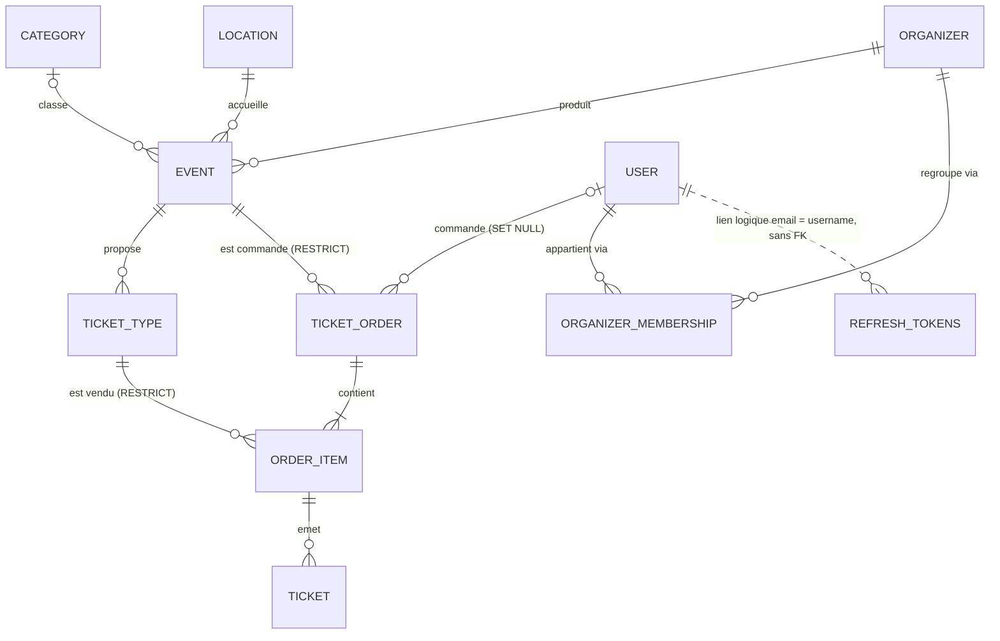
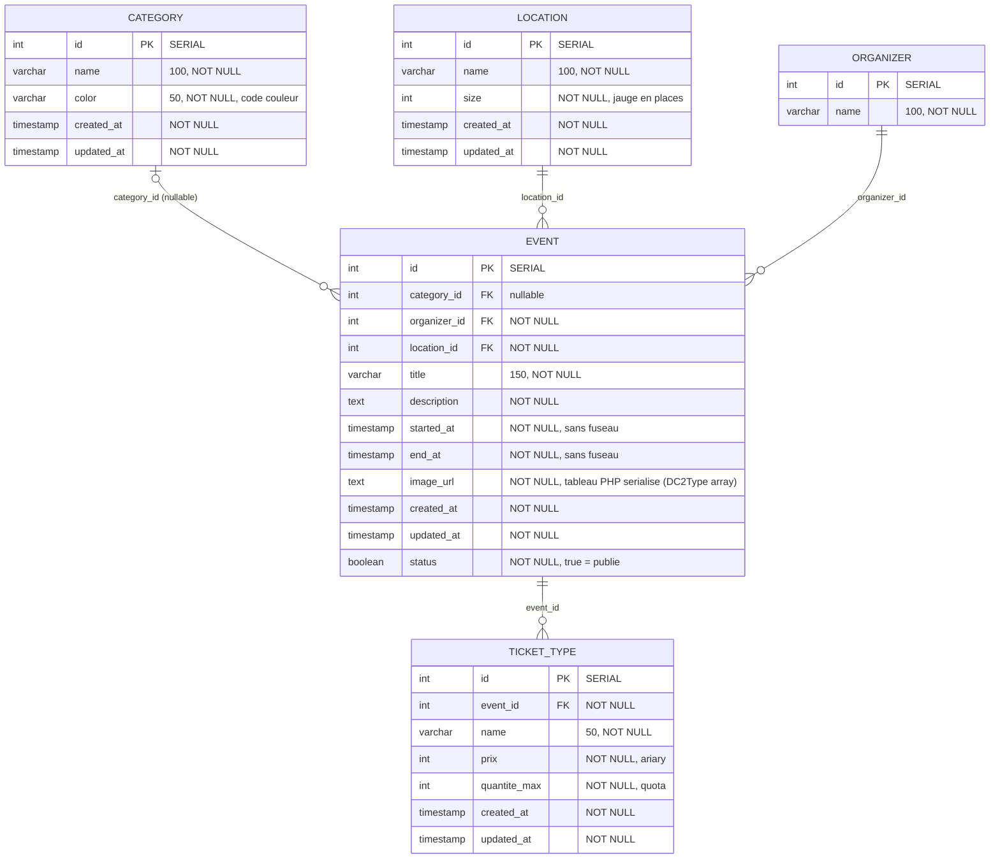
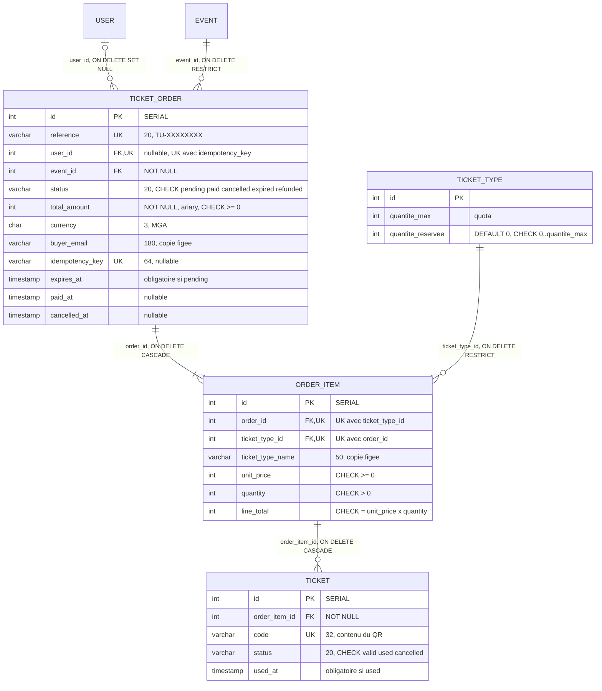
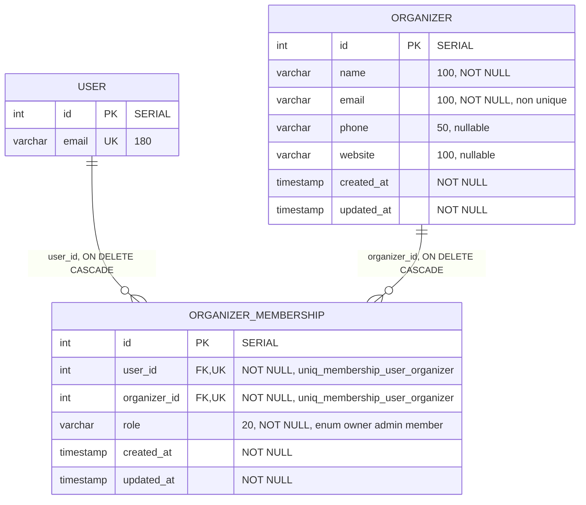
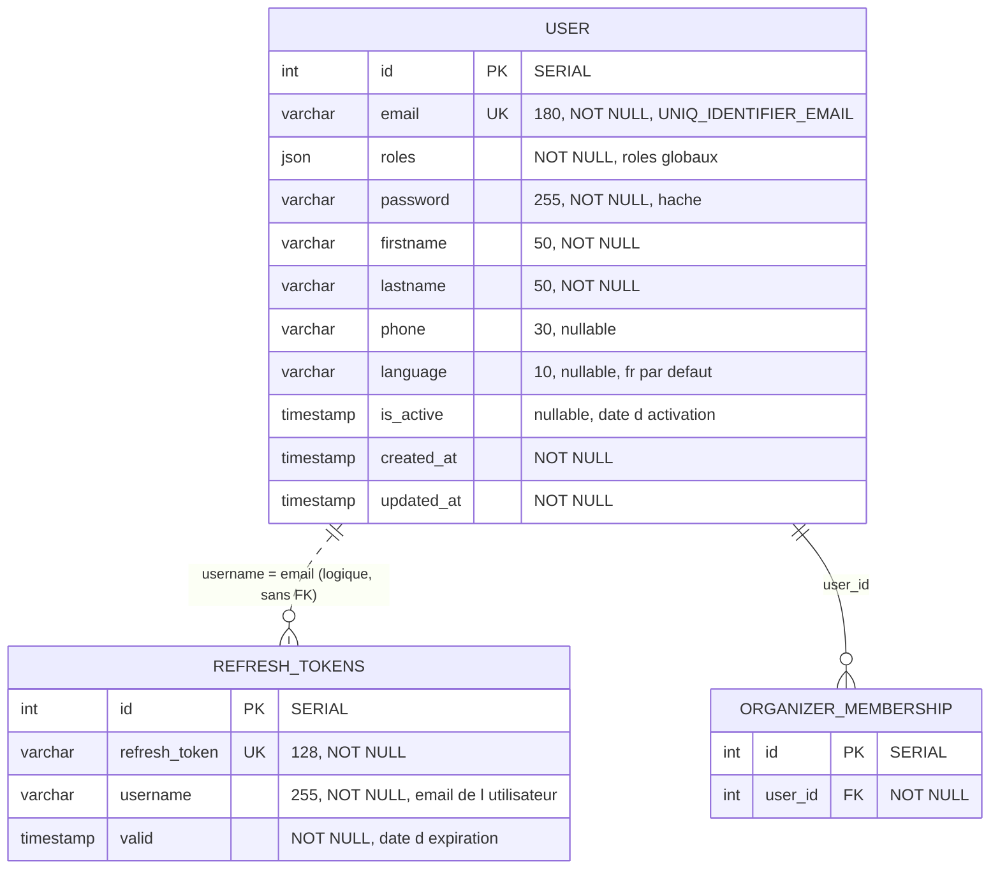

# Diagrammes entité-relation

Sources : `src/Entity/*.php`, `migrations/Version20260814185842.php`.

Conventions des diagrammes :

- les noms d'entités sont ceux des **tables** SQL (`USER` désigne la table `"user"`) ;
- `PK` = clé primaire, `FK` = clé étrangère, `UK` = participe à une contrainte d'unicité ;
- la longueur des `varchar` et les particularités figurent dans le commentaire entre guillemets ;
- `||--o{` = un-à-plusieurs (zéro ou plus côté « plusieurs ») ; `|o--o{` = côté « un » optionnel (FK nullable).

## 1. Diagramme global simplifié

Lecture :

- `event` est la table centrale du catalogue : 3 FK sortantes (`category_id` nullable, `location_id`, `organizer_id`).
- `organizer_membership` matérialise un **many-to-many porté par une entité** entre `user` et `organizer` (avec un rôle). Il n'y a pas de `ManyToMany` Doctrine ni de table de jointure implicite.
- `refresh_tokens` n'a **aucune clé étrangère** : le lien avec `user` est logique (`refresh_tokens.username` contient l'email). Il est représenté en pointillés.

## 2. Domaine Catalogue et Billetterie

`ORGANIZER` est volontairement réduit ici ; son détail est dans le domaine suivant.

## 2 bis. Domaine Commandes

Détail des colonnes et contraintes : [`data-dictionary.md`](data-dictionary.md#ticket_order) et [`design-orders.md`](design-orders.md).

## 3. Domaine Organisations

Contraintes clés de `organizer_membership` :

- unicité `uniq_membership_user_organizer (user_id, organizer_id)` : un seul rôle par personne et par organisation ;
- index `idx_membership_organizer_role (organizer_id, role)` : compter / lister les responsables d'une organisation.

## 4. Domaine Identité et authentification

## 5. Cardinalités exactes

| Relation | Cardinalité | Mapping Doctrine | Table de jointure |
|---|---|---|---|
| `category` → `event` | 0..1 — 0..N | `ManyToOne` (Event) / `OneToMany` (Category) | non |
| `location` → `event` | 1 — 0..N | `ManyToOne` (Event) / `OneToMany` (Location) | non |
| `organizer` → `event` | 1 — 0..N | `ManyToOne` (Event) / `OneToMany` (Organizer) | non |
| `event` → `ticket_type` | 1 — 0..N | `ManyToOne` (TicketType) / `OneToMany` (Event) | non |
| `user` → `ticket_order` | 0..1 — 0..N | `ManyToOne` unidirectionnel (TicketOrder) | non |
| `event` → `ticket_order` | 1 — 0..N | `ManyToOne` unidirectionnel (TicketOrder) | non |
| `ticket_order` → `order_item` | 1 — 1..N | `ManyToOne` (OrderItem) / `OneToMany` (TicketOrder) | non |
| `ticket_type` → `order_item` | 1 — 0..N | `ManyToOne` unidirectionnel (OrderItem) | non |
| `order_item` → `ticket` | 1 — 0..N | `ManyToOne` (Ticket) / `OneToMany` (OrderItem) | non |
| `user` ↔ `organizer` | N — N | 2 × `ManyToOne` depuis `OrganizerMembership` + 2 × `OneToMany` inverses | **`organizer_membership`** (entité à part entière) |
| `user` → `refresh_tokens` | 1 — 0..N (logique) | aucun | non |

Aucune relation `OneToOne` ni `ManyToMany` Doctrine n'existe dans le projet. Détail des cascades : [`relations.md`](relations.md).
